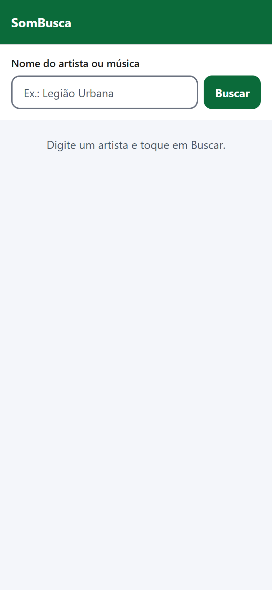
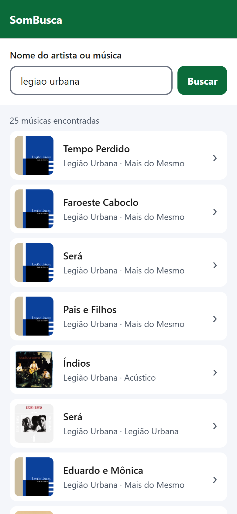
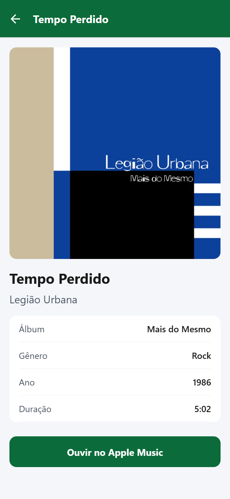
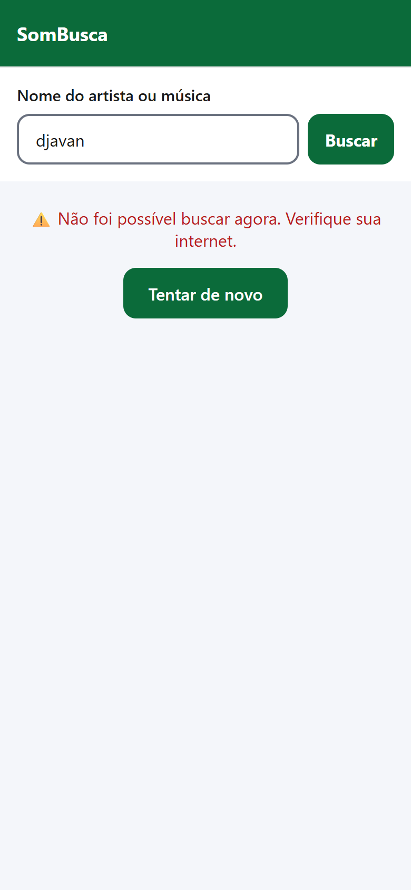

# Aula — Introdução ao React Native e ao ecossistema mobile

> **Projeto da aula:** `sombusca-mobile/`, o SomBusca (busca de músicas na API do iTunes) agora como app de celular.
> **Duração:** de 2h30 a 3h.
> **Pré-requisitos:** JavaScript, React básico (componentes, props, `useState`) e consumo de API com `fetch`, tudo visto nas aulas anteriores.
> **Versões usadas:** Expo SDK 58, React Native 0.88, React 19.3 e Expo Router 58 (novembro de 2026).

---

## Sumário

1. [Roteiro da aula](#1-roteiro-da-aula)
2. [O ecossistema mobile: nativo, híbrido, PWA e multiplataforma](#2-o-ecossistema-mobile)
3. [O que é React Native e de onde ele veio](#3-o-que-é-react-native)
4. [Do React para o React Native: o que muda](#4-do-react-para-o-react-native)
5. [Bibliotecas do ecossistema](#5-bibliotecas-do-ecossistema)
6. [Expo, Expo Go e a conta Expo](#6-expo-expo-go-e-a-conta-expo)
7. [Managed x Bare: a história e como é hoje (CNG)](#7-managed-x-bare-a-história-e-como-é-hoje)
8. [EAS / Expo Services: build, APK, AAB e publicação](#8-eas--expo-services)
9. [Mão na massa: criando o SomBusca Mobile](#9-mão-na-massa-criando-o-sombusca-mobile)
10. [O código, arquivo por arquivo e linha por linha](#10-o-código-arquivo-por-arquivo)
11. [Rodando o app](#11-rodando-o-app)
12. [Gerando o APK com Expo Build](#12-gerando-o-apk-com-expo-build)
13. [Boas práticas: organização e reutilização](#13-boas-práticas)
14. [Exercícios](#14-exercícios)
15. [Glossário](#15-glossário)
16. [Referências](#16-referências)

---

## 1. Roteiro da aula

| Tempo | Bloco | O que acontece |
|---|---|---|
| 0:00 – 0:25 | Ecossistema mobile | Nativo x híbrido x PWA x multiplataforma, com os trade-offs de cada um |
| 0:25 – 0:50 | React Native | História, arquitetura e comparação com o React da web |
| 0:50 – 1:10 | Expo | Expo Go, conta Expo, managed/bare e CNG, Expo Services (EAS) |
| 1:10 – 1:20 | *Intervalo* | |
| 1:20 – 1:35 | Setup | Criar o projeto, instalar o Expo Go e abrir o app no celular |
| 1:35 – 2:30 | Código | Tema, serviço da API, componentes, tela de busca, navegação e tela de detalhes |
| 2:30 – 2:45 | Build | Demonstração do `eas build` gerando APK, com explicação de APK x AAB |
| 2:45 – 3:00 | Fechamento | Boas práticas, dúvidas e exercícios |

> **Dica:** o build na nuvem pode ficar alguns minutos na fila no plano gratuito. Dispare o `eas build` **no começo da aula** (ou na véspera) e mostre o resultado no bloco de build.

---

## 2. O ecossistema mobile

Para criar um app de celular, há quatro caminhos principais. Nenhum é "o melhor": cada um troca alguma coisa por outra (os **trade-offs**).

### 2.1 Nativo

O app é escrito na linguagem oficial de cada sistema:

| Plataforma | Linguagem | Ferramenta | Interface |
|---|---|---|---|
| Android | Kotlin (antes Java) | Android Studio | Jetpack Compose (antes XML) |
| iOS | Swift (antes Objective-C) | Xcode (só roda no Mac) | SwiftUI (antes UIKit) |

- ✅ Máximo desempenho e acesso imediato a todo recurso novo do sistema.
- ❌ **Dois códigos, duas equipes:** o mesmo app é escrito duas vezes.

### 2.2 Híbrido (WebView)

Um site (HTML, CSS e JS) roda **dentro de um navegador embutido** no app, a WebView. Exemplos: Apache Cordova (antigo PhoneGap), Ionic e Capacitor.

- ✅ Reaproveita quase 100% do conhecimento web.
- ❌ A interface **é uma página web**: rolagem, gestos e animações nem sempre parecem nativos, e o desempenho cai em telas pesadas.

### 2.3 PWA (Progressive Web App)

É um **site** que pode ser "instalado" na tela inicial, funciona offline (com Service Worker) e tem um manifesto (`manifest.json`).

- ✅ Não passa por loja, atualiza na hora e tem um só código.
- ❌ Acesso limitado ao hardware (Bluetooth, NFC, recursos em segundo plano). No iOS o suporte é mais restrito: as notificações push, por exemplo, só funcionam a partir do iOS 16.4 e com o app instalado na tela inicial.

### 2.4 Multiplataforma com interface nativa

Escreve-se **um código** que gera **componentes nativos de verdade**. Os principais são:

- **React Native** (Meta, JavaScript/TypeScript), o foco desta aula.
- **Flutter** (Google, linguagem Dart). Ele desenha a própria interface com um motor gráfico, em vez de usar os componentes do sistema.
- **Kotlin Multiplatform** (JetBrains), que compartilha a lógica e, opcionalmente, a interface.

### 2.5 Comparando os quatro caminhos

| Critério | Nativo | Híbrido (WebView) | PWA | React Native |
|---|---|---|---|---|
| Códigos para Android + iOS | 2 | 1 | 1 | 1 |
| Linguagem | Kotlin / Swift | HTML/CSS/JS | HTML/CSS/JS | JS/TS + React |
| Aparência | 100% nativa | Web | Web | Nativa (componentes reais) |
| Desempenho | ⭐⭐⭐⭐⭐ | ⭐⭐ | ⭐⭐ | ⭐⭐⭐⭐ |
| Acesso ao hardware | Total | Por plugins | Limitado | Total (via módulos nativos) |
| Loja de apps | Sim | Sim | Não precisa | Sim |
| Curva para quem já sabe React | Alta | Baixa | Baixa | **Baixa** |

> **Pergunta para a turma:** um app de banco, um jogo 3D e o cardápio de uma lanchonete devem usar a mesma tecnologia? Por quê?

---

## 3. O que é React Native

**React Native (RN)** é um framework de código aberto, criado pelo Facebook (hoje Meta), para construir apps **Android e iOS** usando **React**.

> O lema do projeto é **"Learn once, write anywhere"**: aprenda React uma vez e use em qualquer lugar. Não é "escreva uma vez, rode em qualquer lugar": cada plataforma ainda tem suas particularidades.

### 3.1 Linha do tempo

| Ano | Acontecimento |
|---|---|
| 2013 | O React é lançado para a web. Num hackathon interno do Facebook, nasce o protótipo de "React para apps nativos" |
| 2015 (jan) | O React Native é apresentado na React.js Conf |
| 2015 (mar) | Vira código aberto, com suporte a iOS |
| 2015 (set) | Ganha suporte a Android |
| 2015 | Nasce o **Expo**, uma empresa à parte, para tornar o React Native mais fácil |
| 2022 | O **Hermes**, motor JavaScript feito para celulares, vira o padrão |
| 2024 | A **Nova Arquitetura** (JSI, Fabric, TurboModules) vira o padrão no RN 0.76 |
| Hoje | A documentação oficial (reactnative.dev) recomenda criar projetos **com Expo** |

Apps conhecidos que usam React Native: Facebook, Instagram, Discord, Shopify, Coinbase e Bluesky, entre muitos outros.

### 3.2 Como funciona por dentro

```
┌──────────────────────────────┐        ┌──────────────────────────────┐
│   Seu código JavaScript      │        │   Lado nativo (Android/iOS)  │
│   (React, componentes,       │  JSI   │   Componentes de verdade:    │
│    estado, fetch...)         │◄──────►│   android.view.View,         │
│   roda no motor Hermes       │        │   UIView, UILabel...         │
└──────────────────────────────┘        └──────────────────────────────┘
```

1. O seu JavaScript roda no **Hermes**, um motor JS otimizado para celular.
2. Quando você escreve `<View>` ou `<Text>`, o React Native **não cria HTML**. Ele manda o sistema criar o componente **nativo** equivalente.
3. **Arquitetura antiga:** JS e nativo conversavam por uma **"ponte" (Bridge)**, trocando mensagens em JSON de forma assíncrona. Funcionava, mas era um gargalo.
4. **Nova Arquitetura**, padrão hoje:
   - **JSI (JavaScript Interface):** o JS chama funções nativas **diretamente**, sem converter para JSON.
   - **Fabric:** o novo renderizador da interface, mais rápido e compatível com os recursos novos do React.
   - **TurboModules:** módulos nativos (câmera, sensores...) carregados **só quando são usados**.

> **Resumo para a turma:** o React Native não é um "site dentro do app". Os botões, textos e listas são **componentes nativos do sistema**, controlados pelo JavaScript.

---

## 4. Do React para o React Native

Quem já sabe React, sabe **quase tudo**. A lógica (componentes, props, `useState`, `useEffect`, `fetch`, `async/await`) é **idêntica**. O que muda são os **componentes base** e o **estilo**.

### 4.1 Tabela de equivalência

| Web (React + HTML) | React Native | Observação |
|---|---|---|
| `<div>` | `<View>` | Caixa de layout |
| `<p>`, `<span>`, `<h1>` | `<Text>` | **Todo texto precisa estar dentro de `<Text>`** |
| `` | `<Image source={{ uri: '...' }} />` | Precisa de largura e altura |
| `<button onClick>` | `<Pressable onPress>` | "Click" vira "press" (toque) |
| `<input onChange>` | `<TextInput onChangeText>` | Recebe o texto direto, sem `event.target.value` |
| `<ul>` + `.map()` | `<FlatList>` | Lista otimizada para listas grandes |
| Rolagem automática da página | `<ScrollView>` | No celular a rolagem **não é automática** |
| CSS / Tailwind | `StyleSheet.create({...})` | Objeto JS, em camelCase e sem "px" |
| `react-router` | **Expo Router** | Navegação por arquivos |
| `window.location`, `<a href>` | `router.push()`, `<Link>` | |
| `localStorage` | `AsyncStorage` / `expo-sqlite` | |

### 4.2 Estilo: parece CSS, mas não é

```js
// Web (CSS)                         // React Native (StyleSheet)
// .titulo {                         titulo: {
//   font-size: 16px;                  fontSize: 16,          // camelCase e número puro
//   background-color: #fff;           backgroundColor: '#fff',
//   display: flex;                    // não precisa: TODA View já é flex
// }                                 }
```

Diferenças importantes:

- **Toda `View` já é flexbox**, e a direção padrão é **coluna** (`flexDirection: 'column'`). Na web, o padrão é linha.
- As unidades são **dp** (pixels independentes de densidade), escritas como número puro: `16`, não `'16px'`.
- **Não existe cascata nem herança:** o estilo de uma `View` não passa para o `Text` de dentro. A exceção é `Text` dentro de `Text`.
- Não há `:hover`, porque no celular não existe mouse. O `Pressable` dá o estado `pressed`.
- Não há classes nem seletores: o estilo é passado **direto** em cada componente com `style={...}`.

### 4.3 Componentes centrais (todos usados no app)

| Componente | Para que serve | Onde usamos |
|---|---|---|
| `View` | Contêiner de layout (flexbox) | Todas as telas |
| `Text` | Qualquer texto | Todas as telas |
| `Image` | Imagem local ou da internet | Capas dos álbuns |
| `ScrollView` | Área com rolagem; desenha **tudo** de uma vez | Tela de detalhes |
| `FlatList` | Lista com rolagem; desenha **só o que aparece** na tela | Lista de músicas |
| `TextInput` | Campo de texto | Campo de busca |
| `Pressable` | Qualquer área tocável | Botões e cartões |
| `ActivityIndicator` | Indicador de carregando, nativo do sistema | Estado de carregando |

> **ScrollView ou FlatList?** Use o `ScrollView` para conteúdo **pequeno e fixo**, como uma tela de detalhes. Use o `FlatList` para listas **grandes ou vindas de API**. Com 1.000 itens, o `ScrollView` desenharia os 1.000 e travaria; o `FlatList` desenha uns 10.

---

## 5. Bibliotecas do ecossistema

O React Native traz só o básico. O resto vem de bibliotecas. As mais importantes:

| Categoria | Biblioteca | Para que serve |
|---|---|---|
| **Framework** | **Expo** | Ferramentas, SDK de módulos nativos e serviços de build. É o padrão recomendado |
| **Navegação** | **Expo Router** | Navegação por arquivos, como no Next.js. **Usado na aula** |
| | React Navigation | Navegação configurada em código. O Expo Router é construído em cima dela |
| **Recursos nativos (Expo SDK)** | `expo-camera`, `expo-location`, `expo-image-picker`, `expo-notifications`, `expo-audio`, `expo-image`, `expo-sqlite`... | Câmera, GPS, galeria, notificações, áudio, imagens com cache, banco local |
| **Animação e gestos** | `react-native-reanimated`, `react-native-gesture-handler` | Animações a 60 fps e gestos (arrastar, pinçar) |
| **Telas e áreas seguras** | `react-native-screens`, `react-native-safe-area-context` | Telas nativas e respeito ao "notch" e às bordas arredondadas. **Instaladas na aula** |
| **Dados do servidor** | TanStack Query (React Query) | Cache, recarregar e paginar dados de API |
| **Estado global** | Zustand, Redux Toolkit, Context API | Compartilhar dados entre telas |
| **Armazenamento** | AsyncStorage, `expo-secure-store` | Guardar preferências e, de forma segura, tokens |
| **Estilo** | NativeWind | Tailwind no React Native (os alunos já viram Tailwind) |
| **Componentes prontos** | React Native Paper, Tamagui, Gluestack | Kits de interface |

> **Regra de ouro:** instale bibliotecas com **`npx expo install nome`**, e não com `npm install`. O Expo escolhe a versão **compatível com o SDK** do projeto.

---

## 6. Expo, Expo Go e a conta Expo

### 6.1 O que é o Expo

O **Expo** é um **framework para React Native**: o Expo está para o React Native como o Next.js está para o React. Ele oferece:

| Peça | O que é |
|---|---|
| **Expo CLI** (`npx expo ...`) | Comandos para criar, rodar e configurar o projeto |
| **Metro** | O "bundler": junta todos os arquivos JS em um pacote e entrega ao celular |
| **Expo SDK** | Dezenas de módulos nativos prontos (`expo-camera`, `expo-location`...) |
| **Expo Router** | Navegação por arquivos |
| **Expo Go** | App de testes (veja abaixo) |
| **Expo Services (EAS)** | Serviços na nuvem: build, envio às lojas e atualizações |

### 6.2 Expo Go

O **Expo Go** é um app que você instala no celular pela **Play Store** ou pela **App Store**. Ele já vem com o **Expo SDK inteiro** compilado dentro.

**Como funciona:**

```
 Computador                                   Celular
┌───────────────────┐   Wi-Fi (mesma rede)  ┌──────────────────┐
│ npx expo start    │ ────────────────────► │ Expo Go          │
│ (Metro serve o JS)│   lê o QR Code        │ (roda o seu JS)  │
└───────────────────┘                       └──────────────────┘
```

1. No computador, `npx expo start` liga o Metro e mostra um **QR Code**.
2. No celular, o **Expo Go** lê o QR Code: no Android pelo próprio Expo Go, no iPhone pela **câmera**.
3. O Expo Go baixa o seu JavaScript e roda. Ao salvar um arquivo, o app atualiza na hora (**Fast Refresh**).

**Vantagens:** não precisa de Android Studio nem de Xcode, nem de compilar nada. É ideal para aprender e para a aula.

**Limitações (importante):**

- O Expo Go só tem os módulos nativos que **já vêm dentro dele**. Se o projeto usar uma biblioteca com código nativo que não está no Expo Go, é preciso um **development build** (seção 7.4).
- Cada versão do Expo Go roda **um SDK específico**. Se aparecer *"Project is incompatible with this version of Expo Go"*, atualize o Expo Go na loja ou alinhe o SDK do projeto.

### 6.3 Criando a conta Expo

A conta é **gratuita** e é necessária para:

- usar o Expo Go em um **iPhone físico** (veja o aviso abaixo);
- gerar builds (APK/AAB) com o **Expo Build** (EAS Build);
- publicar atualizações e acessar o painel em **expo.dev**.

**Passo a passo:**

1. Acesse **https://expo.dev/signup**.
2. Preencha e-mail, **username** (vai aparecer nas URLs dos seus projetos) e senha, ou entre com GitHub.
3. Confirme o e-mail.
4. No terminal do computador, faça login:
   ```bash
   npx expo login
   ```
5. Confira com qual conta você está logado:
   ```bash
   npx expo whoami
   ```
6. No **Expo Go**, toque no ícone de conta (canto superior direito) e entre com **a mesma conta**.

> ⚠️ **iPhone físico:** o Expo Go **exige** que o Expo CLI (computador) e o Expo Go (celular) estejam logados **na mesma conta**. Senão aparece *"You need to be signed in to Expo Go and Expo CLI"*. No Android, no emulador e no simulador essa exigência **não existe**.

---

## 7. Managed x Bare: a história e como é hoje

Este é um ponto em que muito material na internet está **desatualizado**. Vale contar a história, porque os alunos vão encontrar esses termos.

### 7.1 Como era (até ~2022)

| Modo | Como funcionava |
|---|---|
| **Managed workflow** (gerenciado) | Você só escrevia JavaScript. As pastas `android/` e `ios/` **não existiam**: o Expo cuidava de tudo. Era simples, mas **limitado** e não permitia código nativo próprio |
| **Bare workflow** ("puro", "pelado") | O projeto tinha as pastas `android/` e `ios/` **no repositório**, e você mexia direto no código nativo (Java/Kotlin, Objective-C/Swift). Era flexível, mas **difícil de manter e de atualizar** |
| **Eject** ("ejetar") | O comando `expo eject` transformava um projeto managed em bare. **Era só de ida**: não dava para voltar |

### 7.2 Como é hoje: CNG (Continuous Native Generation)

O `expo eject` foi **removido no SDK 46 (2022)**. Hoje, segundo a própria documentação do Expo, a divisão "managed x bare" é **uma distinção ultrapassada**: todos os projetos Expo usam a mesma arquitetura.

**CNG (Geração Nativa Contínua)** significa que as pastas `android/` e `ios/` **são geradas automaticamente quando precisam existir**, e depois podem ser apagadas e geradas de novo.

```
app.json + package.json + config plugins
               │
               ▼   npx expo prebuild   (ou automático no build na nuvem)
      ┌────────────────────┐
      │ android/   ios/    │   ← geradas; NÃO edite à mão
      └────────────────────┘
               │
               ▼
          APK / AAB / IPA
```

- Toda configuração nativa (nome, ícone, permissões, pacote) fica no **`app.json`**.
- Para mexer em algo nativo específico, usa-se um **config plugin**: uma função que altera o projeto nativo durante a geração.
- Por isso as pastas `android/` e `ios/` ficam no **`.gitignore`**.

### 7.3 E o "bare" hoje?

O termo ainda aparece para projetos React Native que **mantêm as pastas nativas** no repositório. Normalmente são projetos criados sem Expo (com o React Native Community CLI) ou que precisam editar o nativo à mão. Mesmo nesses projetos dá para usar as ferramentas do Expo.

| | Projeto Expo com CNG (padrão) | Projeto com nativo versionado ("bare") |
|---|---|---|
| Pastas `android/` e `ios/` | Geradas, fora do Git | Ficam no Git e são editadas à mão |
| Configuração nativa | `app.json` + config plugins | Direto nos arquivos nativos |
| Atualizar a versão do RN | Simples: trocar o SDK e gerar de novo | Trabalhosa: aplicar diferenças nos arquivos nativos |
| Quando usar | **Quase sempre** | Integração com um app nativo existente ou necessidades muito específicas |

### 7.4 Expo Go x Development Build

|  | Expo Go | Development build |
|---|---|---|
| O que é | App pronto da loja | **O seu próprio app**, em versão de desenvolvimento (com `expo-dev-client`) |
| Módulos nativos | Só os que vêm no Expo Go | **Qualquer biblioteca** |
| Precisa compilar? | Não | Sim, uma vez (`eas build --profile development` ou `npx expo run:android`) |
| Uso ideal | Aprender, protótipos, **esta aula** | Projetos reais |

---

## 8. EAS / Expo Services

### 8.1 O nome mudou

Os serviços na nuvem do Expo se chamavam **EAS (Expo Application Services)**. Hoje se chamam **Expo Services**. Os serviços são os mesmos e **os comandos continuam `eas`**.

| Nome antigo | Nome atual | O que faz |
|---|---|---|
| EAS Build | **Expo Build** | Compila o app (APK, AAB, IPA) **na nuvem**, sem Android Studio nem Xcode |
| EAS Submit | **Expo Submit** | Envia o app para a Google Play e a App Store |
| EAS Update | **Expo Update** | Atualizações "over-the-air": corrige o JS sem passar de novo pela loja |
| EAS Workflows | **Expo Workflows** | CI/CD: automatiza build, testes e publicação |
| EAS CLI | **EAS CLI** (não mudou) | A ferramenta de linha de comando: `eas build`, `eas submit`... |

O arquivo de configuração continua sendo o **`eas.json`**.

### 8.2 Formatos de arquivo

| Formato | Plataforma | Para que serve | Instala direto no celular? |
|---|---|---|---|
| **APK** (Android Package) | Android | Testes, distribuição direta, emulador | ✅ Sim |
| **AAB** (Android App Bundle) | Android | **Publicar na Google Play**: a loja gera APKs otimizados por aparelho. É obrigatório para apps novos desde 2021 | ❌ Não |
| **IPA** | iOS | Publicar na App Store e no TestFlight | Só com conta Apple Developer |

> O **padrão do Expo Build no Android é AAB**. Para gerar **APK**, é preciso configurar um perfil no `eas.json` (seção 12).

### 8.3 Custos (para os alunos saberem)

| Item | Custo |
|---|---|
| Conta Expo + Expo Build (plano gratuito) | Grátis, com fila de espera e limite mensal de builds |
| Google Play Console (publicar na loja) | Taxa única de US$ 25 |
| Apple Developer Program (publicar ou instalar em iPhone) | US$ 99 por ano |

---

## 9. Mão na massa: criando o SomBusca Mobile

O app é o **SomBusca**, que os alunos já conhecem da versão web, agora no celular. Assim dá para comparar **lado a lado** o que muda do React para o React Native: a API, o `fetch` e os 4 estados (carregando, vazio, sucesso, erro) são **os mesmos**.

### 9.1 O app pronto

| Busca (início) | Resultados | Detalhes |
|---|---|---|
|  |  |  |

| Nada encontrado | Erro de conexão |
|---|---|
|  |  |

**Duas telas, com transição em pilha (Stack):**

1. **Busca:** campo, botão, lista de resultados e os 4 estados.
2. **Detalhes:** capa grande, informações e botão "Ouvir no Apple Music". Abre ao tocar em uma música, e a seta ← volta.

### 9.2 Pré-requisitos

- **Node.js LTS** instalado (`node -v` deve mostrar a versão).
- **VS Code**.
- **Expo Go** no celular (Play Store ou App Store), **atualizado**.
- Celular e computador **na mesma rede Wi-Fi** (ou use `--tunnel`, seção 11).

### 9.3 Passo a passo de criação

Estes são exatamente os comandos usados para criar o projeto.

**1. Criar o projeto com o template em branco:**

```bash
npx create-expo-app@latest sombusca-mobile --template blank
```

- `npx` executa um pacote sem instalá-lo globalmente.
- `create-expo-app@latest` é o criador oficial de projetos Expo, na versão mais recente.
- `--template blank` cria um projeto mínimo, só com `App.js`. O template padrão já vem com abas e TypeScript, o que é demais para a primeira aula.

**2. Instalar o Expo Router e as dependências dele:**

```bash
cd sombusca-mobile
npx expo install expo-router react-native-safe-area-context react-native-screens expo-linking expo-constants expo-status-bar
```

| Pacote | Para que serve |
|---|---|
| `expo-router` | Navegação por arquivos |
| `react-native-safe-area-context` | Descobre as áreas seguras da tela ("notch", barra de gestos) |
| `react-native-screens` | Usa telas **nativas** do sistema na navegação (mais desempenho) |
| `expo-linking` | Links e deep links (abrir o app por uma URL) |
| `expo-constants` | Informações do app e do aparelho |
| `expo-status-bar` | Controla a barra de status (hora, bateria) |

**3. (Opcional) Suporte a web**, para quem estiver sem celular:

```bash
npx expo install react-native-web react-dom
```

**4. Trocar o ponto de entrada no `package.json`:**

```json
"main": "expo-router/entry"
```

Antes, o app começava pelo `index.js` → `App.js`. Agora começa pelo **Expo Router**, que procura as telas na pasta `src/app/`. Por isso **apagamos** o `App.js` e o `index.js`.

**5. Ajustar o `app.json`:**

```json
{
  "expo": {
    "name": "SomBusca",
    "slug": "sombusca-mobile",
    "scheme": "sombusca",
    "ios": { "supportsTablet": true, "bundleIdentifier": "br.usjt.sombusca" },
    "android": { "package": "br.usjt.sombusca" },
    "plugins": ["expo-router", "expo-status-bar"]
  }
}
```

| Campo | O que significa |
|---|---|
| `name` | Nome que aparece embaixo do ícone no celular |
| `slug` | Identificador do projeto na conta Expo (vai na URL do expo.dev) |
| `scheme` | Permite abrir o app por link: `sombusca://musica/123` (deep link) |
| `android.package` / `ios.bundleIdentifier` | **Identidade única** do app nas lojas, em formato de domínio invertido. **Não pode mudar depois de publicar** |
| `plugins` | Config plugins que alteram o projeto nativo durante a geração (CNG) |

(O arquivo real tem também ícone, splash e orientação, que vieram do template.)

**6. Verificar a saúde do projeto:**

```bash
npx expo-doctor
```

O resultado esperado é `20/20 checks passed. No issues detected!`

### 9.4 Estrutura de pastas

```
sombusca-mobile/
├── app.json               ← configuração do app (nome, ícone, pacote, plugins)
├── package.json           ← dependências e "main": "expo-router/entry"
├── assets/                ← ícones e splash
└── src/
    ├── app/               ← ROTAS: cada arquivo aqui é uma TELA
    │   ├── _layout.js     ← navegador (Stack) que envolve todas as telas
    │   ├── index.js       ← tela 1: busca         → rota "/"
    │   └── musica/
    │       └── [id].js    ← tela 2: detalhes      → rota "/musica/123"
    ├── components/        ← peças reutilizáveis (NÃO são telas)
    │   ├── MusicaCard.js  ← cartão de uma música
    │   └── Estado.js      ← carregando / vazio / erro
    ├── services/
    │   └── itunes.js      ← conversa com a API (fetch)
    └── theme.js           ← cores e espaçamentos
```

**Regra do Expo Router:** **tudo** que está dentro de `src/app/` vira tela. Por isso componentes, serviços e tema ficam **fora** dessa pasta.

| Arquivo | Rota (URL) |
|---|---|
| `src/app/index.js` | `/` |
| `src/app/musica/[id].js` | `/musica/713691774`, `/musica/qualquer-coisa`... |
| `src/app/_layout.js` | Não é rota: é o **layout** que envolve as rotas da pasta |

Os **colchetes** `[id]` criam uma **rota dinâmica**: o pedaço da URL nessa posição chega na tela como o parâmetro `id`.

---

## 10. O código, arquivo por arquivo

Cada arquivo do projeto tem **um comentário acima de cada linha** explicando o que ela faz. Abaixo estão os arquivos na **ordem em que devem ser escritos em aula**, de baixo para cima: primeiro as peças, depois as telas. Depois de cada arquivo vêm os conceitos principais que ele ensina.

### 10.1 `src/theme.js`: tokens de design

```js
// theme.js — "tokens de design": cores e medidas usadas no app inteiro.
// Mudar uma cor aqui muda em todas as telas (consistência, heurística H4 de Nielsen).

// Exporta um objeto com as cores do app
export const cores = {
  // Fundo das telas: cinza bem claro, cansa menos a vista que branco puro
  fundo: '#F4F6FA',
  // Fundo dos cartões e do campo de busca
  superficie: '#FFFFFF',
  // Texto principal: contraste ≈ 17:1 sobre o fundo (WCAG pede no mínimo 4.5:1)
  texto: '#1A1A1A',
  // Texto secundário (artista, álbum): contraste ≈ 7.5:1 sobre branco
  textoSuave: '#4B5563',
  // Cor de destaque (botões, cabeçalho): verde escuro, contraste ≈ 6.6:1 com branco
  primaria: '#0B6B3A',
  // Texto que fica em cima da cor primária
  textoNaPrimaria: '#FFFFFF',
  // Borda do campo de busca: contraste ≈ 4.8:1, acima dos 3:1 exigidos para componentes
  borda: '#6B7280',
  // Cor de erro: vermelho escuro, contraste ≈ 6.5:1 sobre branco
  erro: '#B91C1C',
};

// Exporta os espaçamentos padrão (múltiplos de 4, um padrão comum em design de interfaces)
export const espaco = {
  // Espaço pequeno: entre textos
  p: 4,
  // Espaço médio: entre elementos
  m: 8,
  // Espaço grande: margens das telas
  g: 16,
  // Espaço extra grande: separação de blocos
  gg: 24,
};

// Raio de arredondamento padrão dos cantos
export const raio = 12;
```

**Conceitos:**
- No React Native **não há CSS global nem variáveis CSS**. Um arquivo JS com constantes faz esse papel.
- `export const` permite importar só o que precisa: `import { cores } from '../theme'`.
- São as mesmas cores (e os mesmos contrastes WCAG) da versão web das aulas anteriores.

### 10.2 `src/services/itunes.js`: consumo da API

```js
// services/itunes.js — toda a comunicação com a API do iTunes fica neste arquivo.
// As telas não sabem montar URL nem tratar HTTP: só chamam estas funções.
// Isso separa responsabilidades e permite reutilizar a busca em qualquer tela.

// Endereço base da API pública do iTunes (não precisa de chave)
const BASE_URL = 'https://itunes.apple.com';

// Busca músicas pelo termo digitado. "async" = a função devolve uma Promise.
export async function buscarMusicas(termo) {
  // Monta a URL; encodeURIComponent troca espaços e acentos por códigos seguros
  const url = `${BASE_URL}/search?term=${encodeURIComponent(termo)}&media=music&entity=song&country=BR&limit=25`;
  // Faz a requisição HTTP GET e espera a resposta chegar
  const resposta = await fetch(url);
  // fetch só falha sozinho sem internet; erro do servidor (404, 500) precisa ser checado aqui
  if (!resposta.ok) throw new Error(`Erro HTTP ${resposta.status}`);
  // Converte o texto JSON da resposta em objeto JavaScript
  const dados = await resposta.json();
  // Devolve só a lista de músicas (array "results")
  return dados.results;
}

// Busca os detalhes de UMA música pelo id dela (trackId)
export async function buscarMusicaPorId(id) {
  // O endpoint "lookup" devolve o item com aquele id
  const url = `${BASE_URL}/lookup?id=${encodeURIComponent(id)}&country=BR`;
  // Faz a requisição e espera
  const resposta = await fetch(url);
  // Trata erro HTTP do mesmo jeito que na busca
  if (!resposta.ok) throw new Error(`Erro HTTP ${resposta.status}`);
  // Converte JSON em objeto
  const dados = await resposta.json();
  // Devolve o primeiro (e único) resultado, ou null se a música não existir
  return dados.results[0] ?? null;
}

// Troca a capa de 100x100 por uma versão maior (a API aceita outros tamanhos na URL)
export function capaGrande(musica, tamanho = 600) {
  // Substitui o trecho "100x100" da URL pelo tamanho pedido, ex.: "600x600"
  return musica.artworkUrl100.replace('100x100', `${tamanho}x${tamanho}`);
}
```

**Conceitos:**
- **O `fetch` é o mesmo da web.** O React Native já traz `fetch`, `Promise` e `async/await` prontos, sem instalar nada.
- **Camada de serviço:** as telas não sabem que existe uma API do iTunes; só chamam `buscarMusicas()`. Se a API mudar, só este arquivo muda.
- `??` é o operador de "coalescência nula": se `dados.results[0]` for `undefined`, devolve `null`.
- **Diferença do mobile:** no celular **não existe CORS**. Ele é uma regra do navegador; um app nativo chama qualquer API.
- **Endpoints usados:**
  - `GET /search?term=...`: lista de músicas.
  - `GET /lookup?id=...`: uma música pelo id.

### 10.3 `src/components/Estado.js`: carregando, vazio e erro

```js
// components/Estado.js — mensagem de estado da tela: carregando, vazio ou erro.
// As duas telas usam este mesmo componente (reutilização, consistência H4).

// Importa os componentes nativos usados aqui
import { ActivityIndicator, Pressable, StyleSheet, Text, View } from 'react-native';
// Importa o tema
import { cores, espaco, raio } from '../theme';

// Props: "tipo" ('carregando' | 'vazio' | 'erro'), a mensagem e, opcionalmente, a ação de tentar de novo
export default function Estado({ tipo, mensagem, onTentarDeNovo }) {
  // Retorna o bloco de estado
  return (
    // accessibilityLiveRegion: no Android, o leitor de tela anuncia sozinho quando a mensagem muda (H1)
    <View style={estilos.caixa} accessibilityLiveRegion="polite">
      {/* Se estiver carregando, mostra o indicador giratório nativo do sistema */}
      {tipo === 'carregando' && <ActivityIndicator size="large" color={cores.primaria} />}
      {/* A mensagem; no erro ela fica vermelha E com ícone, não só pela cor (WCAG 1.4.1) */}
      <Text style={[estilos.mensagem, tipo === 'erro' && estilos.erro]}>
        {tipo === 'erro' ? '⚠️ ' : ''}
        {mensagem}
      </Text>
      {/* No erro, oferece uma saída: tentar de novo (heurísticas H3 e H9) */}
      {tipo === 'erro' && onTentarDeNovo && (
        // Botão de tentar novamente
        <Pressable
          // Executa a função recebida por props
          onPress={onTentarDeNovo}
          // Leitor de tela anuncia como botão
          accessibilityRole="button"
          // Muda a aparência enquanto é pressionado
          style={({ pressed }) => [estilos.botao, pressed && { opacity: 0.7 }]}
        >
          {/* Texto do botão */}
          <Text style={estilos.textoBotao}>Tentar de novo</Text>
        </Pressable>
      )}
    </View>
  );
}
```

*(Os estilos completos, com um comentário por linha, estão no arquivo.)*

**Conceitos:**
- **Renderização condicional** com `&&`, igual ao React web.
- **Array de estilos:** `style={[estilos.mensagem, tipo === 'erro' && estilos.erro]}`. O segundo estilo só é aplicado se a condição for verdadeira e **sobrescreve** o primeiro. É o equivalente a ter duas classes CSS.
- O **`style` como função** no `Pressable` recebe `{ pressed }`, que vale `true` enquanto o dedo está em cima. Isso substitui o `:hover` e o `:active` do CSS.
- **Acessibilidade no mobile:** `accessibilityRole` diz *o que* o elemento é, e `accessibilityLiveRegion` faz o leitor de tela anunciar mudanças. Leitores de tela: **TalkBack** no Android e **VoiceOver** no iOS.

### 10.4 `src/components/MusicaCard.js`: cartão reutilizável

```js
// components/MusicaCard.js — cartão de UMA música na lista de resultados.
// É um componente reutilizável: recebe os dados por props e avisa o clique por onPress.

// Importa os componentes nativos do React Native que este cartão usa
import { Image, Pressable, StyleSheet, Text, View } from 'react-native';
// Importa as cores, espaços e raio do tema
import { cores, espaco, raio } from '../theme';
// Importa a função que gera a URL da capa em tamanho maior
import { capaGrande } from '../services/itunes';

// O componente recebe duas props: os dados da música e a função chamada ao tocar
export default function MusicaCard({ musica, onPress }) {
  // Retorna o que deve aparecer na tela
  return (
    // Pressable = área que responde ao toque (equivale a um <button> da web)
    <Pressable
      // Função executada quando o usuário toca no cartão
      onPress={onPress}
      // Diz ao leitor de tela que isto é um botão
      accessibilityRole="button"
      // Texto que o leitor de tela fala (TalkBack no Android, VoiceOver no iOS)
      accessibilityLabel={`${musica.trackName}, de ${musica.artistName}. Ver detalhes`}
      // style pode ser uma função: "pressed" é true enquanto o dedo está em cima (feedback, H1)
      style={({ pressed }) => [estilos.cartao, pressed && estilos.pressionado]}
    >
      {/* Image precisa de largura e altura; "uri" é uma imagem da internet */}
      <Image source={{ uri: capaGrande(musica, 200) }} style={estilos.capa} />
      {/* View = caixa de layout (equivale a uma <div>) com os textos */}
      <View style={estilos.textos}>
        {/* Todo texto em React Native precisa estar dentro de <Text>; numberOfLines corta com "…" */}
        <Text style={estilos.titulo} numberOfLines={2}>
          {musica.trackName}
        </Text>
        {/* Artista e álbum, em cor mais suave (hierarquia visual) */}
        <Text style={estilos.info} numberOfLines={1}>
          {musica.artistName} · {musica.collectionName}
        </Text>
      </View>
      {/* Seta indicando que o cartão leva a outra tela; o leitor de tela ignora (é decorativa) */}
      <Text style={estilos.seta} importantForAccessibility="no" accessibilityElementsHidden>
        ›
      </Text>
    </Pressable>
  );
}

// StyleSheet.create organiza os estilos. Parece CSS, mas é objeto JS: camelCase e números sem "px"
const estilos = StyleSheet.create({
  // Estilo do cartão inteiro
  cartao: {
    // Coloca capa, textos e seta lado a lado (no React Native o padrão é coluna)
    flexDirection: 'row',
    // Centraliza os itens na vertical
    alignItems: 'center',
    // Espaço entre capa, textos e seta
    gap: espaco.g,
    // Espaço interno do cartão
    padding: espaco.m,
    // Altura mínima de 72: área de toque bem maior que os 48 recomendados
    minHeight: 72,
    // Fundo branco
    backgroundColor: cores.superficie,
    // Cantos arredondados
    borderRadius: raio,
  },
  // Aparência enquanto o dedo pressiona o cartão
  pressionado: {
    // Fica levemente transparente, mostrando que o toque foi reconhecido
    opacity: 0.7,
  },
  // Capa do álbum
  capa: {
    // Largura de 64 (unidade = "dp", pixels independentes de densidade da tela)
    width: 64,
    // Altura igual: capa quadrada
    height: 64,
    // Cantos arredondados um pouco menores que os do cartão
    borderRadius: 8,
    // Cor de fundo enquanto a imagem carrega
    backgroundColor: cores.fundo,
  },
  // Bloco com título e info
  textos: {
    // flex: 1 = ocupa todo o espaço que sobrar na linha
    flex: 1,
    // Pequeno espaço entre título e info
    gap: espaco.p,
  },
  // ... (titulo, info e seta: ver o arquivo)
});
```

**Conceitos:**
- **Componente reutilizável:** recebe `musica` e `onPress` por **props**. Ele não sabe o que acontece ao ser tocado: quem decide é a tela que o usa.
- **`<Image source={{ uri }}>`:** imagens da internet usam `{ uri: '...' }`. Imagens locais usam `require('./foto.png')`. **Sem `width` e `height`, a imagem não aparece.**
- **`numberOfLines`:** corta o texto com "…". No CSS, o equivalente é `text-overflow: ellipsis`.
- **`flexDirection: 'row'`:** no React Native o padrão é **coluna**, então para colocar lado a lado é preciso pedir `row`.
- **`flex: 1`:** "ocupe todo o espaço que sobrar". É a forma mais comum de dividir espaço no React Native.

### 10.5 `src/app/_layout.js`: a navegação (Stack)

```js
// app/_layout.js — layout RAIZ do Expo Router. É o primeiro arquivo que o app carrega.
// Ele define o "navegador": aqui, uma PILHA (Stack) de telas, como cartas empilhadas.
// Abrir uma tela = empilhar por cima. Voltar = tirar a de cima.

// Stack é o navegador em pilha do Expo Router (usa as telas nativas do Android/iOS por baixo)
import { Stack } from 'expo-router';
// StatusBar controla a barra do topo do celular (hora, bateria, sinal)
import { StatusBar } from 'expo-status-bar';
// Importa as cores do tema
import { cores } from '../theme';

// Todo layout exporta um componente padrão
export default function Layout() {
  // Retorna o navegador
  return (
    // Fragmento <>...</>: agrupa dois elementos sem criar caixa extra na tela
    <>
      {/* style="light" = ícones brancos na barra de status, combinando com o cabeçalho verde */}
      <StatusBar style="light" />
      {/* screenOptions vale para TODAS as telas da pilha (consistência, H4) */}
      <Stack
        screenOptions={{
          // Cor de fundo do cabeçalho
          headerStyle: { backgroundColor: cores.primaria },
          // Cor do título e da seta de voltar
          headerTintColor: cores.textoNaPrimaria,
          // Título em negrito
          headerTitleStyle: { fontWeight: '700' },
          // Cor de fundo de todas as telas
          contentStyle: { backgroundColor: cores.fundo },
        }}
      >
        {/* Configura a tela do arquivo app/index.js (a primeira tela) */}
        <Stack.Screen name="index" options={{ title: 'SomBusca' }} />
        {/* Configura a tela do arquivo app/musica/[id].js; o título real é trocado lá dentro */}
        <Stack.Screen name="musica/[id]" options={{ title: 'Detalhes' }} />
      </Stack>
    </>
  );
}
```

**Conceitos: tipos de navegação no mobile**

| Navegador | Como funciona | Exemplo |
|---|---|---|
| **Stack (pilha)** | As telas se empilham e o "voltar" desempilha | Lista → Detalhes. **Usado na aula** |
| **Tabs (abas)** | Barra de abas no rodapé | Instagram: Início, Busca, Perfil |
| **Drawer (gaveta)** | Menu que desliza da lateral | Gmail |
| **Modal** | Tela que sobe por cima | Formulário de "Nova postagem" |

```
  router.push('/musica/123')           botão ← ou gesto de voltar
 ┌──────────┐      ┌──────────┐              ┌──────────┐
 │          │      │ Detalhes │  ◄── topo    │          │
 │  Busca   │ ───► ├──────────┤      ───►    │  Busca   │
 │          │      │  Busca   │              │          │
 └──────────┘      └──────────┘              └──────────┘
```

- O **cabeçalho com seta ←**, a **animação de transição** e o **gesto de voltar** (deslizar no iOS, botão voltar no Android) vêm **de graça** com o Stack.
- O `_layout.js` é como um "molde" que envolve todas as telas da pasta.

### 10.6 `src/app/index.js`: tela 1, a busca

```js
// app/index.js — TELA 1: busca de músicas.
// No Expo Router, cada arquivo dentro de app/ vira uma tela. "index" é a rota "/" (a inicial).

// useState guarda dados que, quando mudam, fazem a tela se redesenhar
import { useState } from 'react';
// Componentes nativos usados nesta tela
import { FlatList, Keyboard, Pressable, StyleSheet, Text, TextInput, View } from 'react-native';
// useRouter dá acesso às funções de navegação (push, back...)
import { useRouter } from 'expo-router';
// Nossos componentes reutilizáveis
import MusicaCard from '../components/MusicaCard';
import Estado from '../components/Estado';
// Função que consulta a API
import { buscarMusicas } from '../services/itunes';
// Tema
import { cores, espaco, raio } from '../theme';

// Componente da tela de busca
export default function TelaBusca() {
  // Objeto de navegação
  const router = useRouter();
  // Texto digitado no campo (começa vazio)
  const [termo, setTermo] = useState('');
  // Lista de músicas recebida da API (começa vazia)
  const [musicas, setMusicas] = useState([]);
  // Estado da tela: 'inicio' | 'carregando' | 'vazio' | 'erro' | 'sucesso'
  const [estado, setEstado] = useState('inicio');
  // Termo da última busca feita (não muda se o usuário editar o campo depois)
  const [buscado, setBuscado] = useState('');

  // Função que faz a busca; async porque espera a API
  async function buscar() {
    // Tira espaços do começo e do fim
    const texto = termo.trim();
    // Prevenção de erro (H5): não busca se o campo estiver vazio
    if (!texto) return;
    // Fecha o teclado para o usuário ver os resultados
    Keyboard.dismiss();
    // Guarda o termo buscado para usar na mensagem de "nada encontrado"
    setBuscado(texto);
    // Estado 1: carregando (H1, visibilidade do status)
    setEstado('carregando');
    // try/catch: se algo falhar, cai no catch em vez de travar o app
    try {
      // Chama a API e espera a lista
      const resultado = await buscarMusicas(texto);
      // Guarda a lista no estado (a tela se redesenha com ela)
      setMusicas(resultado);
      // Estado 2 ou 3: vazio se não veio nada, sucesso se veio
      setEstado(resultado.length === 0 ? 'vazio' : 'sucesso');
    } catch {
      // Estado 4: erro (sem internet, API fora do ar...)
      setEstado('erro');
    }
  }

  // Função chamada ao tocar em uma música: abre a tela de detalhes
  function abrirDetalhes(musica) {
    // Empilha a rota /musica/[id], trocando [id] pelo id real da música
    router.push({ pathname: '/musica/[id]', params: { id: musica.trackId } });
  }

  // O que a tela mostra
  return (
    // View raiz ocupando a tela toda (flex: 1)
    <View style={estilos.tela}>
      {/* Bloco de busca */}
      <View style={estilos.busca}>
        {/* Rótulo sempre visível: não some como o placeholder (H6) */}
        <Text style={estilos.rotulo} nativeID="rotuloBusca">
          Nome do artista ou música
        </Text>
        {/* Linha com o campo e o botão lado a lado */}
        <View style={estilos.linha}>
          {/* TextInput = campo de texto (equivale ao <input> da web) */}
          <TextInput
            // Valor exibido vem do estado (componente "controlado")
            value={termo}
            // A cada letra digitada, atualiza o estado
            onChangeText={setTermo}
            // Ao tocar em "buscar" no teclado, faz a busca (eficiência, H7)
            onSubmitEditing={buscar}
            // Mostra a tecla "Buscar"/lupa no teclado do celular
            returnKeyType="search"
            // Texto de exemplo dentro do campo
            placeholder="Ex.: Legião Urbana"
            // Cor do placeholder com contraste suficiente
            placeholderTextColor={cores.textoSuave}
            // Não corrige o texto automaticamente (nomes de artistas são "estranhos")
            autoCorrect={false}
            // Liga o campo ao rótulo para o leitor de tela (Android)
            accessibilityLabelledBy="rotuloBusca"
            // Rótulo falado pelo leitor de tela (iOS e Android)
            accessibilityLabel="Nome do artista ou música"
            // Estilo do campo
            style={estilos.campo}
          />
          {/* Botão de buscar */}
          <Pressable
            // Faz a busca ao tocar
            onPress={buscar}
            // Anunciado como botão
            accessibilityRole="button"
            // Feedback visual ao pressionar
            style={({ pressed }) => [estilos.botao, pressed && { opacity: 0.7 }]}
          >
            {/* Texto do botão */}
            <Text style={estilos.textoBotao}>Buscar</Text>
          </Pressable>
        </View>
      </View>

      {/* Mostra um estado diferente conforme a variável "estado" */}
      {estado === 'inicio' && (
        <Estado tipo="vazio" mensagem="Digite um artista e toque em Buscar." />
      )}
      {estado === 'carregando' && <Estado tipo="carregando" mensagem="Buscando músicas…" />}
      {estado === 'vazio' && (
        <Estado tipo="vazio" mensagem={`Nenhuma música encontrada para “${buscado}”.`} />
      )}
      {estado === 'erro' && (
        <Estado
          tipo="erro"
          mensagem="Não foi possível buscar agora. Verifique sua internet."
          onTentarDeNovo={buscar}
        />
      )}

      {/* FlatList: lista otimizada, só desenha os itens que aparecem na tela */}
      {estado === 'sucesso' && (
        <FlatList
          // Os dados da lista
          data={musicas}
          // Chave única de cada item (como o "key" do .map() no React web)
          keyExtractor={(item) => String(item.trackId)}
          // Como desenhar cada item: um MusicaCard
          renderItem={({ item }) => (
            <MusicaCard musica={item} onPress={() => abrirDetalhes(item)} />
          )}
          // Espaço entre os cartões
          ItemSeparatorComponent={() => <View style={{ height: espaco.m }} />}
          // Texto acima da lista com a quantidade de resultados (H1)
          ListHeaderComponent={
            <Text style={estilos.contagem}>{musicas.length} músicas encontradas</Text>
          }
          // Espaço interno da lista
          contentContainerStyle={estilos.lista}
          // Permite tocar em um item mesmo com o teclado aberto
          keyboardShouldPersistTaps="handled"
        />
      )}
    </View>
  );
}

// (Os estilos completos, com um comentário por linha, estão no arquivo.)
```

**Conceitos:**

- **Uma variável `estado` em vez de vários booleanos.** Com `carregando`, `erro` e `vazio` separados, seria possível ficar com dois ligados ao mesmo tempo. Com um único `estado`, a tela está **sempre em exatamente um** dos 5: `inicio`, `carregando`, `vazio`, `erro` ou `sucesso`.
- **`TextInput` controlado:** `value={termo}` com `onChangeText={setTermo}`. Na web era `onChange={(e) => setTermo(e.target.value)}`; no React Native o texto chega **direto**.
- **Teclado do celular:** `returnKeyType="search"` troca a tecla Enter por uma lupa, `onSubmitEditing` faz a busca ao tocá-la e `Keyboard.dismiss()` fecha o teclado. Na web, o teclado não é um problema.
- **`FlatList`:**

  | Prop | Equivalente na web |
  |---|---|
  | `data` | O array que você daria ao `.map()` |
  | `renderItem={({ item }) => ...}` | A função de dentro do `.map()`. **Atenção:** recebe `{ item }`, não o item direto |
  | `keyExtractor` | O `key={...}` de cada item. Precisa ser **string** |
  | `ListHeaderComponent` | Algo que aparece **antes** do primeiro item e rola junto |
  | `ItemSeparatorComponent` | Algo entre os itens |

- **Navegando:** `router.push({ pathname: '/musica/[id]', params: { id } })` empilha a tela de detalhes, trocando `[id]` pelo id real. O resultado é a rota `/musica/713691774`.

### 10.7 `src/app/musica/[id].js`: tela 2, os detalhes

```js
// app/musica/[id].js — TELA 2: detalhes de uma música.
// Os colchetes no nome do arquivo criam uma ROTA DINÂMICA: /musica/713691774, /musica/123...
// O valor que estiver no lugar de [id] chega na tela como parâmetro.

// useEffect roda código quando a tela aparece; useState guarda dados
import { useEffect, useState } from 'react';
// Componentes nativos usados nesta tela
import { Image, Linking, Pressable, ScrollView, StyleSheet, Text, View } from 'react-native';
// Stack (para mudar o título do cabeçalho) e o hook que lê os parâmetros da rota
import { Stack, useLocalSearchParams } from 'expo-router';
// Nosso componente de estado
import Estado from '../../components/Estado';
// Funções da API
import { buscarMusicaPorId, capaGrande } from '../../services/itunes';
// Tema
import { cores, espaco, raio } from '../../theme';

// Converte milissegundos em "m:ss" (ex.: 301000 → "5:01")
function formatarDuracao(ms) {
  // Total de segundos
  const total = Math.round(ms / 1000);
  // Minutos inteiros
  const minutos = Math.floor(total / 60);
  // Segundos restantes, sempre com 2 dígitos ("5" vira "05")
  const segundos = String(total % 60).padStart(2, '0');
  // Monta o texto final
  return `${minutos}:${segundos}`;
}

// Componente da tela de detalhes
export default function TelaDetalhes() {
  // Lê o "id" da URL (o que veio no lugar de [id])
  const { id } = useLocalSearchParams();
  // A música carregada (null enquanto não chegou)
  const [musica, setMusica] = useState(null);
  // Estado da tela: 'carregando' | 'erro' | 'sucesso'
  const [estado, setEstado] = useState('carregando');
  // Contador usado para refazer a busca ao tocar em "Tentar de novo"
  const [tentativa, setTentativa] = useState(0);

  // useEffect: roda quando a tela abre e sempre que "id" ou "tentativa" mudarem
  useEffect(() => {
    // Marca se a tela ainda está aberta (evita atualizar uma tela que já foi fechada)
    let ativo = true;
    // Mostra o carregando
    setEstado('carregando');
    // Chama a API (Promise com .then/.catch, outra forma de lidar com código assíncrono)
    buscarMusicaPorId(id)
      // Quando a resposta chegar...
      .then((resultado) => {
        // ...se o usuário já voltou para a tela anterior, não faz nada
        if (!ativo) return;
        // Guarda a música
        setMusica(resultado);
        // Se não achou, é erro; se achou, sucesso
        setEstado(resultado ? 'sucesso' : 'erro');
      })
      // Se a requisição falhar, mostra o erro
      .catch(() => ativo && setEstado('erro'));
    // Função de "limpeza": roda quando a tela fecha
    return () => {
      // Marca que a tela não está mais ativa
      ativo = false;
    };
    // Lista de dependências: o efeito roda de novo se algum destes mudar
  }, [id, tentativa]);

  // Enquanto carrega, mostra só o indicador
  if (estado === 'carregando') {
    return <Estado tipo="carregando" mensagem="Carregando música…" />;
  }

  // Se deu erro, mostra a mensagem com a opção de tentar de novo
  if (estado === 'erro') {
    return (
      <Estado
        tipo="erro"
        mensagem="Não foi possível carregar esta música."
        onTentarDeNovo={() => setTentativa((n) => n + 1)}
      />
    );
  }

  // Ano de lançamento: pega os 4 primeiros caracteres da data ("2013-05-17T..." → "2013")
  const ano = musica.releaseDate?.slice(0, 4);

  // Sucesso: mostra os detalhes
  return (
    // ScrollView: deixa rolar a tela se o conteúdo for maior que ela
    <ScrollView contentContainerStyle={estilos.conteudo}>
      {/* Troca o título do cabeçalho pelo nome da música */}
      <Stack.Screen options={{ title: musica.trackName }} />
      {/* Capa grande; accessibilityLabel descreve a imagem para o leitor de tela */}
      <Image
        source={{ uri: capaGrande(musica, 600) }}
        style={estilos.capa}
        accessibilityLabel={`Capa do álbum ${musica.collectionName}`}
      />
      {/* Nome da música; role "header" = é um título para o leitor de tela */}
      <Text style={estilos.titulo} accessibilityRole="header">
        {musica.trackName}
      </Text>
      {/* Nome do artista */}
      <Text style={estilos.artista}>{musica.artistName}</Text>

      {/* Cartão com as informações em linhas "rótulo: valor" */}
      <View style={estilos.cartao}>
        <Info rotulo="Álbum" valor={musica.collectionName} />
        <Info rotulo="Gênero" valor={musica.primaryGenreName} />
        <Info rotulo="Ano" valor={ano} />
        <Info rotulo="Duração" valor={formatarDuracao(musica.trackTimeMillis)} />
      </View>

      {/* Botão que abre a música no Apple Music (app ou navegador) */}
      <Pressable
        // Linking.openURL abre um link fora do app
        onPress={() => Linking.openURL(musica.trackViewUrl)}
        // Anunciado como link
        accessibilityRole="link"
        // Feedback ao pressionar
        style={({ pressed }) => [estilos.botao, pressed && { opacity: 0.7 }]}
      >
        {/* Texto do botão */}
        <Text style={estilos.textoBotao}>Ouvir no Apple Music</Text>
      </Pressable>
    </ScrollView>
  );
}

// Componente pequeno, usado só nesta tela: uma linha "rótulo — valor"
function Info({ rotulo, valor }) {
  // Se a API não mandou esse dado, não mostra a linha
  if (!valor) return null;
  // Linha com o rótulo à esquerda e o valor à direita
  return (
    <View style={estilos.linhaInfo}>
      <Text style={estilos.rotulo}>{rotulo}</Text>
      <Text style={estilos.valor}>{valor}</Text>
    </View>
  );
}

// (Os estilos completos, com um comentário por linha, estão no arquivo.)
```

**Conceitos:**

- **Rota dinâmica + `useLocalSearchParams()`:** o arquivo `[id].js` atende a qualquer `/musica/ALGO`, e o hook devolve `{ id: 'ALGO' }`. Por que passar só o **id**, e não a música inteira? Porque assim a tela funciona **sozinha**: se alguém abrir o link `sombusca://musica/713691774` (deep link), ela busca os dados por conta própria.
- **`useEffect` com dependências `[id, tentativa]`:** a busca roda quando a tela abre e de novo quando o `id` ou a `tentativa` mudam. O botão "Tentar de novo" só **soma 1** na tentativa, e isso dispara o efeito de novo.
- **A função de limpeza (`return () => { ativo = false }`):** se o usuário voltar antes de a resposta chegar, o app não tenta atualizar uma tela que já fechou.
- **Retorno antecipado:** os `if (estado === ...) return ...` antes do `return` principal deixam o código mais legível que uma cadeia de ternários.
- **`<Stack.Screen options={{ title }} />` dentro da tela:** muda o título do cabeçalho **dinamicamente**, com o nome da música.
- **`ScrollView`:** é a tela de detalhes, com conteúdo pequeno e fixo, então aqui ele é a escolha certa (compare com o `FlatList` da tela 1).
- **`Linking.openURL`:** abre um link **fora** do app (Apple Music, navegador, telefone `tel:`, e-mail `mailto:`...).
- **`?.` (encadeamento opcional):** `musica.releaseDate?.slice(0, 4)` não quebra se `releaseDate` não existir.

---

## 11. Rodando o app

### 11.1 No celular, com o Expo Go (recomendado)

```bash
cd sombusca-mobile
npm install          # só na primeira vez, se clonou o repositório
npx expo start
```

1. Aparece um **QR Code** no terminal.
2. **Android:** abra o **Expo Go** e toque em *Scan QR code*. **iPhone:** abra a **câmera** e aponte para o QR Code (antes, faça login na mesma conta; veja a seção 6.3).
3. O app abre no celular. **Edite um texto, salve, e veja mudar na hora** (Fast Refresh).

### 11.2 Teclas úteis no terminal do `expo start`

| Tecla | O que faz |
|---|---|
| `a` | Abre no **emulador Android** (precisa do Android Studio) |
| `i` | Abre no **simulador iOS** (só no Mac) |
| `w` | Abre no **navegador** (versão web) |
| `r` | Recarrega o app |
| `j` | Abre o **depurador** (DevTools) |
| `m` | Abre o menu de desenvolvimento no aparelho |

### 11.3 Problemas comuns

| Problema | Solução |
|---|---|
| O celular não conecta (rede da faculdade bloqueia a comunicação entre aparelhos) | `npx expo start --tunnel`: cria um túnel pela internet |
| *"Project is incompatible with this version of Expo Go"* | Atualize o Expo Go na loja |
| *"You need to be signed in..."* (iPhone) | `npx expo login` e login no Expo Go com a **mesma conta** |
| Tela vermelha de erro | Leia a mensagem: ela mostra **arquivo e linha**. Corrija e salve |
| Mudanças não aparecem | `npx expo start --clear` (limpa o cache do Metro) |
| Firewall do Windows perguntou | Permita o **Node.js** em **redes privadas** |

---

## 12. Gerando o APK com Expo Build

Esta é a demonstração do **Expo Build (EAS Build)**: o app é compilado **na nuvem do Expo**, sem Android Studio.

**1. Login com a conta Expo:**

```bash
npx eas-cli@latest login
npx eas-cli@latest whoami
```

> `npx eas-cli@latest` usa sempre a versão mais nova sem instalar nada. Outra opção é instalar globalmente (`npm install -g eas-cli`) e usar só `eas`.

**2. Configurar o projeto:**

```bash
npx eas-cli@latest build:configure
```

Esse comando:
- vincula o projeto à sua conta (adiciona `extra.eas.projectId` no `app.json`);
- cria o arquivo **`eas.json`** com os **perfis de build**.

**3. Criar um perfil que gere APK.** Edite o `eas.json`:

```json
{
  "build": {
    "development": {
      "developmentClient": true,
      "distribution": "internal"
    },
    "preview": {
      "distribution": "internal",
      "android": {
        "buildType": "apk"
      }
    },
    "production": {}
  }
}
```

| Perfil | O que gera | Para quê |
|---|---|---|
| `development` | APK de **desenvolvimento** (com `expo-dev-client`) | Substituir o Expo Go em projetos reais |
| `preview` | **APK** final | Instalar no celular, mandar para colegas e testar. **É o que usaremos** |
| `production` | **AAB** (o padrão do Android) | Publicar na Google Play |

- `"distribution": "internal"` indica um build para distribuição **interna** (por link), fora da loja.
- `"buildType": "apk"` pede um **APK** em vez do AAB padrão.

**4. Disparar o build:**

```bash
npx eas-cli@latest build -p android --profile preview
```

- `-p android` indica a plataforma (`android`, `ios` ou `all`).
- `--profile preview` escolhe o perfil do `eas.json`.
- Na primeira vez, ele pergunta se pode **gerar um Android Keystore**. Responda **sim**. O keystore é a "assinatura digital" do app, e o Expo guarda ela para você.
- O código sobe para a nuvem e o build entra na fila. Acompanhe pelo link que aparece ou em **expo.dev → seu projeto → Builds**.

**5. Instalar o APK:**

- Ao terminar, aparece um **link e um QR Code**. Abra no celular Android e baixe o `.apk`.
- O Android vai pedir para permitir **"instalar apps desconhecidos"**. Isso é normal para apps fora da loja.
- O ícone **SomBusca** aparece na tela inicial, agora como **app de verdade**, sem o Expo Go.

**6. Para publicar na loja (só para conhecer):**

```bash
npx eas-cli@latest build -p android --profile production   # gera o .aab
npx eas-cli@latest submit -p android                        # envia para a Google Play
```

> **Para comentar em aula:** com o **Expo Update** (`eas update`), dá para corrigir um texto ou um bug **de JavaScript** e mandar a correção para os usuários **sem publicar de novo na loja**. Isso só vale para mudanças em JS: se mudar algo nativo, como uma nova biblioteca nativa, é preciso um novo build.

---

## 13. Boas práticas

### 13.1 Organização (aplicada no projeto)

| Prática | Como aparece no SomBusca |
|---|---|
| **Rotas separadas do resto** | `src/app/` só tem telas; componentes, serviços e tema ficam fora |
| **Camada de serviço** | `services/itunes.js` concentra todo o `fetch`; as telas não montam URL |
| **Componentes reutilizáveis** | `MusicaCard` e `Estado` são usados em mais de um lugar ou deixam a tela mais limpa |
| **Tokens de design** | `theme.js`: uma cor muda em um lugar só |
| **Um estado por tela** | `estado` com valores fixos, em vez de vários booleanos que podem se contradizer |
| **Estilos no fim do arquivo** | `StyleSheet.create` embaixo, com nomes que dizem *o que* é (`titulo`), e não *como* é (`textoGrande`) |
| **Nomes em português e consistentes** | `buscarMusicas`, `abrirDetalhes`, `MusicaCard` |

### 13.2 Experiência do usuário no mobile

- **Área de toque mínima de 44 a 48 dp.** O dedo é muito menos preciso que o mouse.
- **Todo toque precisa de resposta visual** (o `pressed` do `Pressable`).
- **Sempre mostrar os 4 estados:** carregando, vazio, sucesso e erro, **com uma saída** ("Tentar de novo").
- **Pensar no teclado:** a tecla certa (`returnKeyType`), fechar quando não precisa mais e não esconder o conteúdo.
- **Acessibilidade:** `accessibilityRole`, `accessibilityLabel` e contraste. Teste com o **TalkBack** (Android) ou o **VoiceOver** (iOS) ligado.
- **Listas grandes usam `FlatList`, nunca `ScrollView` com `.map()`.**
- **Rede de celular é instável:** trate o erro sempre. O usuário pode estar no metrô.

### 13.3 Regras do Expo

- Instale pacotes com **`npx expo install`**, não com `npm install`.
- **Nunca edite as pastas `android/` e `ios/` à mão.** Configure pelo `app.json` e por config plugins.
- Rode **`npx expo-doctor`** quando algo estranho acontecer.
- O que funciona no **Expo Go** é limitado aos módulos dele. Para bibliotecas nativas extras, use um **development build**.

---

## 14. Exercícios

**Nível 1: estilo e componentes**
1. Mude a cor primária no `theme.js` e veja o app inteiro mudar.
2. No `MusicaCard`, mostre também o **ano** da música embaixo do artista.
3. Troque o `›` do cartão por um texto "Ver" e ajuste o estilo.

**Nível 2: estado e API**
4. Adicione um botão **"Limpar"** que zera o campo e volta ao estado `inicio`.
5. Mostre o **preço** (`trackPrice`) na tela de detalhes, formatado em reais.
6. Na tela de detalhes, adicione um botão **"Ver mais do artista"** que volta para a busca já pesquisando o nome do artista. Dica: `router.push({ pathname: '/', params: { q: musica.artistName } })` e `useLocalSearchParams` na tela 1.

**Nível 3: navegação**
7. Crie uma **terceira tela** `src/app/sobre.js` com informações do app e um botão no cabeçalho da tela 1 para abri-la. Dica: `headerRight` nas `options` do `Stack.Screen`.
8. Transforme o app em **abas** (Busca e Sobre) usando `Tabs` do `expo-router`.

**Desafio**
9. Toque o **trecho de 30 segundos** (`previewUrl`) na tela de detalhes usando a biblioteca **`expo-audio`** (`npx expo install expo-audio`). Leia a documentação da versão 58.
10. Gere o **APK** do seu app com o Expo Build e instale no seu celular.

---

## 15. Glossário

| Termo | Significado |
|---|---|
| **AAB** | Android App Bundle, o formato exigido pela Google Play. Não instala direto no celular |
| **APK** | Android Package, o instalador de app Android. Instala direto no celular |
| **Bare workflow** | Termo antigo: projeto com as pastas nativas versionadas e editadas à mão |
| **Bridge** | A "ponte" da arquitetura antiga do RN, que levava mensagens entre o JS e o nativo |
| **CNG** | Continuous Native Generation: as pastas nativas são geradas a partir da configuração |
| **Config plugin** | Função que altera o projeto nativo durante o `prebuild` |
| **Deep link** | Link que abre uma tela específica do app (`sombusca://musica/123`) |
| **Development build** | Versão de desenvolvimento do *seu* app, que substitui o Expo Go |
| **dp** | Density-independent pixel, a unidade de medida do RN |
| **EAS / Expo Services** | Serviços na nuvem do Expo: Build, Submit, Update, Workflows |
| **Eject** | Comando antigo (removido em 2022) que passava de managed para bare |
| **Expo Go** | App da loja para testar projetos Expo sem compilar |
| **Fabric** | O renderizador da Nova Arquitetura do React Native |
| **Fast Refresh** | Atualização instantânea do app ao salvar o código |
| **Hermes** | Motor JavaScript otimizado para celular, padrão no RN |
| **JSI** | JavaScript Interface: chamada direta entre JS e nativo, sem ponte |
| **Keystore** | Arquivo de assinatura digital do app Android |
| **Managed workflow** | Termo antigo: projeto sem pastas nativas, gerenciado pelo Expo |
| **Metro** | O bundler do React Native: junta e entrega o JavaScript |
| **OTA (over-the-air)** | Atualização do JS enviada direto aos usuários, sem passar pela loja |
| **Prebuild** | O comando `npx expo prebuild`, que gera as pastas `android/` e `ios/` |
| **PWA** | Progressive Web App: site instalável, com recursos offline |
| **Stack** | Navegação em pilha: telas empilhadas, e "voltar" tira a de cima |
| **TurboModules** | Módulos nativos carregados só quando são usados (Nova Arquitetura) |
| **WebView** | Navegador embutido dentro de um app (base dos apps híbridos) |

---

## 16. Referências

- Documentação do React Native: https://reactnative.dev
- Documentação do Expo: https://docs.expo.dev
- Correções de conceitos desatualizados sobre o Expo: https://docs.expo.dev/llms.txt (seção *common misconceptions*)
- Expo Router: https://docs.expo.dev/router/introduction
- CNG e Prebuild: https://docs.expo.dev/workflow/continuous-native-generation
- Nomes EAS → Expo Services: https://docs.expo.dev/eas-to-expo
- Gerar APK: https://docs.expo.dev/build-reference/apk
- Primeiro build: https://docs.expo.dev/build/setup
- Login do Expo Go no iPhone: https://docs.expo.dev/troubleshooting/expo-go-sign-in-required
- Criar conta Expo: https://expo.dev/signup
- API do iTunes (Search API): https://performance-partners.apple.com/search-api
